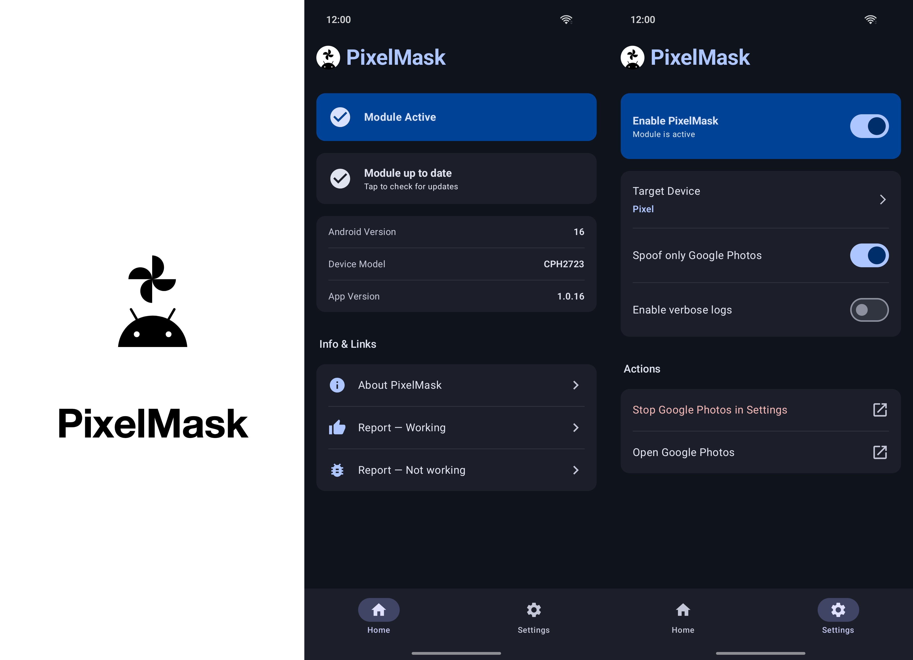
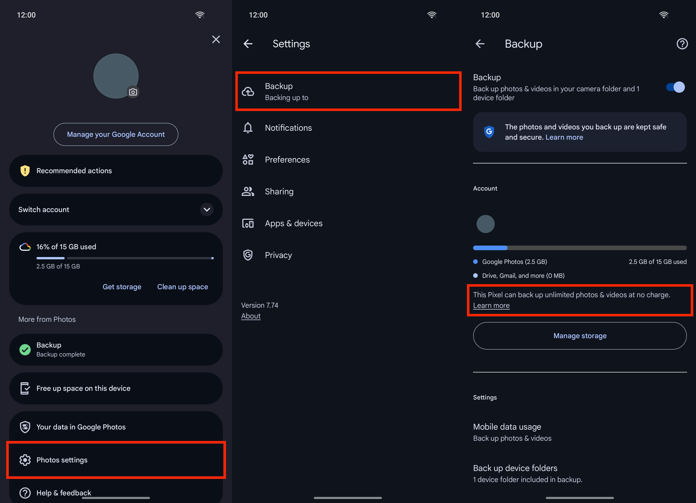

# PixelMask

Make Google Photos believe your phone is a Google Pixel — and unlock
Pixel-only perks like **free unlimited Original-quality backup** on any
rooted Android device.

> Forked from [BaltiApps/Pixelify-Google-Photos](https://github.com/BaltiApps/Pixelify-Google-Photos)
> (EOL since 2024) and rebuilt on a modern stack.

---

## What it does

Google Photos decides whether you're on a Pixel from two things:

- the device fingerprint (`Build.MANUFACTURER`, `MODEL`, `BRAND`, `FINGERPRINT`)
- `hasSystemFeature("PIXEL_<year>_EXPERIENCE")` flags

PixelMask intercepts both, only inside Photos, and replies with the answers a
Pixel of your choosing would give. Photos then turns on the perks tied to that
Pixel.

## Requirements

- Rooted Android 8.0 or newer (`arm64-v8a`)
- An Xposed framework: [LSPosed](https://github.com/LSPosed/LSPosed) on
  Magisk, or [Vector](https://github.com/JingMatrix/Vector) on KernelSU / APatch
- **Android 17:** Vector [canary-3112](https://github.com/JingMatrix/Vector/releases)
  or newer (v2.2 stable crashes Photos)
- Google Photos

## Install

1. Install the latest APK from [Releases](https://github.com/kinginu/PixelMask/releases/latest).
2. In LSPosed / Vector, enable PixelMask and scope it to **Google Photos**.

## Use it

1. Open PixelMask → **Settings tab** → **Target Device**, and pick a Pixel.
2. Tap **Stop Google Photos in Settings** → **Force stop**, then reopen Photos.

## Did it work?

Photos → account icon → **Photos settings** → **Backup** should show:

> **This Pixel can back up unlimited photos & videos at no charge.**

If not, tap **Report — Not working** on the Home tab. It fills in the details
we need.

## Which Pixel should I pick?

| Target | What you get |
|---|---|
| **Pixel** *(default)* | **Unlimited Original-quality backup** |
| Pixel 2 – 5 | Unlimited Storage Saver backup |
| Pixel 6 / 7 (Pro) | No storage perk |
| Pixel 8 Pro | Video Boost, Night Sight Video |
| Pixel 9 Pro XL | Add Me, Reimagine, unlimited Magic Editor |
| Pixel 10 Pro XL | Latest Pixel AI features |

## Updates

The Home tab tells you when a new version is out. Install it over the old one;
settings are kept.

## For developers

See [docs/INTERNALS.md](docs/INTERNALS.md).

## Credits

- [BaltiApps/Pixelify-Google-Photos](https://github.com/BaltiApps/Pixelify-Google-Photos), the original project.
- Launcher icon adapted from [Now in Android](https://github.com/android/nowinandroid)
  (Apache-2.0).

## License

MIT — see [LICENSE](LICENSE).

## Disclaimer

For research and educational use. No warranty; use at your own risk.
